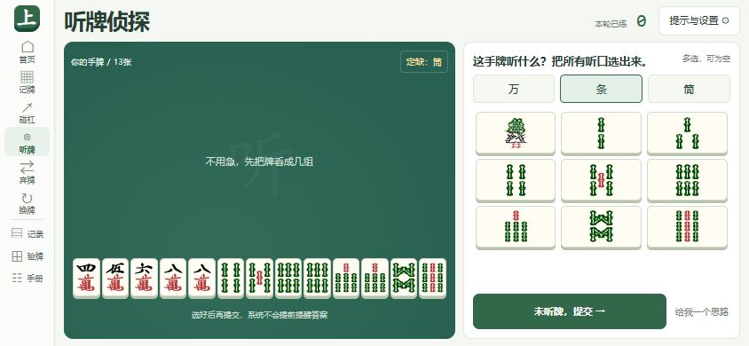
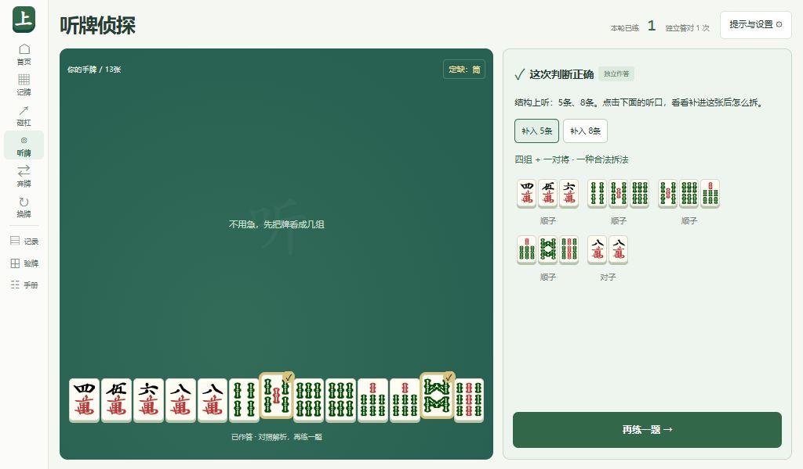

# 上桌 · 川麻练习室


**把“懂规则”，练成“看得出来”。** 面向初学者的四川麻将缺一门专项训练。

[简体中文](README.md) · [English](README.en.md)

[](LICENSE)


知道规则，却在别人出牌时漏掉碰杠，或者打到听牌也没有察觉？上桌把这些困难拆成独立的小练习：先自己判断，再核对答案和拆牌过程，逐步减少对自动提示的依赖。

使用 **Vue 3 + Vite + TypeScript**，无需账号、后端或数据库。已提供桌面、手机竖屏兼容和手机横屏布局，并加入 Capacitor 安卓工程。

> 可通过 GitHub Actions 云端生成离线横屏 APK，无需在本机安装安卓工具链。尚未做安卓真机验证。应用界面目前为中文；本仓库提供中英文 README，尚未提供英文界面切换。

## 目录

- [界面预览](#界面预览)
- [功能](#功能)
- [快速开始](#快速开始)
- [如何练习](#如何练习)
- [规则与边界](#规则与边界)
- [安卓横屏版](#安卓横屏版)
- [数据与隐私](#数据与隐私)
- [项目结构](#项目结构)
- [参与贡献](#参与贡献)
- [致谢与许可证](#致谢与许可证)

## 界面预览

以下为实际运行的网页截图，包含演示练习记录。横屏图片是浏览器预览，不是安卓真机截图。

### 今日练习

进入五项专项训练，查看独立作答统计。


### 手机横屏训练

左侧保留完整手牌，右侧按花色切换九宫格选牌；切换花色保留选择，提交按钮留在栏底。



### 听牌拆解

提交后逐一查看听口，并展示补入该牌后的一种完整合法拆法。



## 功能

| 模块 | 练习内容 |
| --- | --- |
| 手牌快照 | 观察4 / 8 / 12秒后收牌，回忆对子和刻子的牌种 |
| 碰杠反应 | 开牌或收牌作答，主动判断能碰、能直杠或都不能 |
| 听牌侦探 | 从13张手牌中找全听口，混入未听牌题，提交后查看拆解 |
| 打哪张能听 | 从14张牌中找出所有一打即听的弃牌，查看各自听口 |
| 换三张 | 检查同花色三张，模拟换入新牌后重新整理；不判唯一最优换法 |
| 手牌实验室 | 录入未碰杠的13 / 14张牌，核对胡牌、听口和可听弃牌 |
| 练习记录 | 保存最近300次作答，区分独立 / 辅助，支持筛选和原题重做 |

记录默认每页10条，可选20 / 50条。首页展示各专项最近最多20次独立作答的准确率。提示或重看手牌后的作答标为辅助；换三张合法性不计入总体独立识别准确率。

## 快速开始

### 环境要求

- Node.js **22.12或更高版本**，使用 npm。
- 现代浏览器。网页版本无需 Java、Android Studio 或 Android SDK。

### 安装与启动

```sh
git clone https://github.com/lyunsheng051-png/Sichuan-Mahjong.git
cd Sichuan-Mahjong
npm install
npm run dev
```

打开终端输出的本地地址，通常为 `http://127.0.0.1:5173/`。端口被占用时，以 Vite 实际输出为准。

### 常用命令

| 命令 | 用途 |
| --- | --- |
| `npm run dev` | 启动本地开发服务 |
| `npm run typecheck` | Vue / TypeScript 类型检查 |
| `npm run android:open` | 使用 Android Studio 打开原生工程 |
| `npm run android:sync` | 编译网页并同步安卓资源 |
| `npm run android:apk` | 检查原生工具链、编译资源并尝试生成调试 APK |

日常前端验证只运行 `npm run typecheck`。安卓同步与打包还会编译网页资源，不属于普通类型检查；云端打包由手动触发的工作流执行。

## 如何练习

1. **先记得住**：从12秒手牌快照开始，优先记对子和刻子，不要求背完13张牌。
2. **再接得上**：先开牌练碰杠，稳定后收起手牌，练习注意力转移。
3. **看整手结构**：说出完整组、将牌和剩余搭子，再提交听口，与拆解核对。
4. **出牌前检查**：问自己“打完这张，我等什么？”允许答案是“还没听”。
5. **迁移到实物**：摆出真实手牌，先写答案，再用实验室核对，最后尝试慢速亲友局。

每次15～20分钟可作为起点，先求准确，再缩短观察时间。练习次数与程序准确率不等同于实战精通。完整路线与参考进阶线见[训练设计](docs/training-design.md)。

## 规则与边界

### 当前练习规则

- 万、条、筒各一至九，每种4张，共108张。
- 换同一花色三张后定缺；缺门牌优先打，定缺花色不能碰、杠或胡。
- 不能吃。碰杠题专练**碰和直杠**，不评估暗杠、补杠、胡牌优先级或操作收益。
- 普通胡为四组面子加一对将；七对可开关，四张同牌允许作两对。
- 按完整手牌判断听口，排除自己已经持有四张的“第五张牌”。

### 尚未实现

- 完整四人对局、联机匹配与完整血战流程。
- 番数、封顶、过水、查叫、查花猪及杠上炮等结算规则。
- 根据牌河和其他可见牌计算实际剩余张数，或提供防守决策。
- 换三张的四家交换流程、最优策略评分。
- 英文界面切换、跨设备同步、记录自动迁移和内置导入导出。

当前界面出题和实验室均使用未碰杠暗手牌。各地桌规存在差异，实战前应与同桌对齐。

## 安卓横屏版

已加入 Capacitor 8 工程、应用图标与启动页配置。主 Activity 请求 `sensorLandscape`，面向普通手机支持左右横屏；部分平板、折叠屏和分屏窗口可能由系统决定方向。

横屏网页已在740×360、844×390浏览器视窗中核对。提示和设置通过弹层打开，期间暂停观察倒计时；长解析只在右栏内滚动，下一题按钮留在栏底。

**已验证构建：** [2026-10-22 · v0.1.0](https://github.com/lyunsheng051-png/Sichuan-Mahjong/actions/runs/39722626363) 已通过云端原生编译、APK 签名验证及固定签名证书比对。尚未做安卓真机验证。

v0.1.1 修正安卓启动主题导致的顶部图标横条，并在导航栏底部新增带确认弹窗的“退出”入口；保留原包名和签名，可覆盖更新。

**云端打包：** 打开 [Android APK 工作流](https://github.com/lyunsheng051-png/Sichuan-Mahjong/actions/workflows/android-apk.yml)，点击 **Run workflow**。成功后从该次运行的 **Artifacts** 下载 `shangzhuo-android-0.1.1-…`，解压后将 APK 传到手机安装；附件保存7天，过期可重新运行。

工作流使用 Ubuntu、JDK 21 和 Android SDK Platform 36，先检查类型，再编译离线资源并校验 APK 签名，附带 SHA256 校验文件。签名密钥保存在仓库 Secret 中，不包含在源码或下载附件里。尚未做安卓真机验证。完整配置、安装和签名更新说明见[安卓文档](docs/android.md)。

## 数据与隐私

- 练习过程不调用远程服务，训练逻辑和牌面随项目本地提供。
- 设置与最近300次练习保存在当前浏览器 / WebView 的 `localStorage`。
- 不同浏览器、访问地址和 App 的数据空间相互独立，不会自动同步。
- 清除站点数据、清除 App 数据或卸载 App 会丢失相应记录。
- README 徽章由外部服务提供，不是应用运行时依赖。

## 项目结构

```text
.
├── android/                 安卓原生工程、横屏与图标配置
├── docs/
│   ├── images/              中英文 README 共用的实际界面截图
│   ├── android.md           安卓工程与打包说明
│   └── training-design.md   训练目标、规则与进阶路线
├── public/tiles/            万条筒 SVG、牌背与原始许可
├── scripts/                 安卓资源同步和 APK 打包入口
├── src/
│   ├── api/                 本地持久化适配层
│   ├── components/          牌面、选牌器、分页等通用组件
│   ├── composables/         训练状态与进度
│   ├── config/              训练模式和默认设置
│   ├── layouts/             应用布局
│   ├── router/              页面路由
│   ├── services/            胡牌、听牌求解与出题
│   ├── styles/              主题、响应式和横屏样式
│   ├── types/               手牌、规则、题目与记录类型
│   └── views/               页面视图
└── capacitor.config.ts      原生容器配置
```

## 参与贡献

欢迎通过 [Issues](https://github.com/lyunsheng051-png/Sichuan-Mahjong/issues) 报告问题或讨论改进，也可以提交 [Pull Request](https://github.com/lyunsheng051-png/Sichuan-Mahjong/pulls)。

- **规则问题**：提供完整手牌、定缺花色、七对开关、预期和实际结果，并说明当地桌规。
- **界面问题**：提供浏览器或设备信息、横竖屏方向、窗口尺寸和复现步骤；有截图更便于定位。
- **代码修改**：遵循现有分层结构，日常前端检查运行 `npm run typecheck`。不要提交生成的 APK、SDK、本地路径或签名密钥。
- **文档修改**：同步维护中英文 README，截图使用真实界面，区分浏览器预览与真机截图。

规则、教学设计或较大交互改动，建议先在 Issue 中说明预期行为，便于讨论范围。

## 致谢与许可证

- 牌面复用自 [FluffyStuff / riichi-mahjong-tiles](https://github.com/FluffyStuff/riichi-mahjong-tiles)，按原仓库公有领域 / CC0 许可使用，保留了原始许可证和固定提交信息。
- [luxinghong / sichuan-mahjong-analyzer](https://github.com/luxinghong/sichuan-mahjong-analyzer) 用于功能研究参考，未复制源代码。
- 应用代码采用 [MIT License](LICENSE)。第三方素材许可单独说明，详见[第三方素材说明](THIRD_PARTY_NOTICES.md)。
- 新应用图标使用内置图像生成工具制作，原图、安卓适配和生成提示词见[品牌素材说明](assets/branding/README.md)，与第三方牌面素材分别记录。
